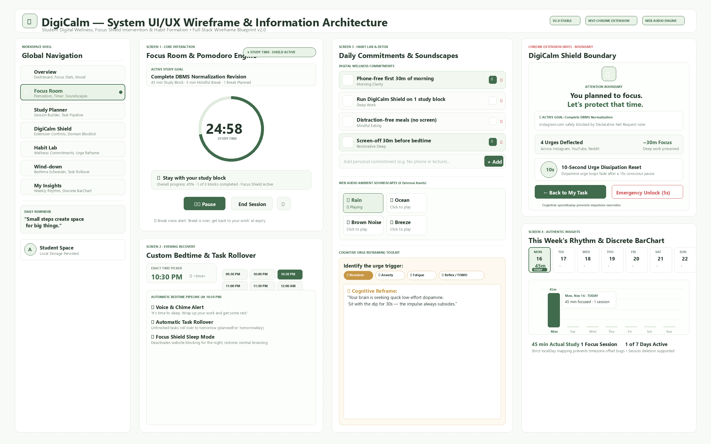

# DigiCalm — Shield Edition 🛡️
### *Digital Wellness & Study Focus Management with Real Website Blocking*

DigiCalm is a research-grounded digital wellness and study planning platform built around empirical survey findings: **students lose planned study time to unplanned, autopilot scrolling**, especially during exam preparation and late at night.

Unlike traditional passive screen-time apps that only deliver post-hoc regret reports, **DigiCalm Shield Edition** pairs a calm, aesthetic React web app with a **Manifest V3 Chrome Extension Companion** that enforces real, network-level website blocking with automatic session expiry.

---

## 🌟 Key Features

### 1. 🛡️ Focus Shield (Real Website Blocking Companion)
- **Actual Navigation Blocking:** Blocks Instagram, YouTube, Reddit, X (Twitter), TikTok, Netflix, and custom domains in Google Chrome.
- **Dedicated Interruption Boundary (`blocked.html`):** Redirects blocked visits to an intentional DigiCalm screen featuring:
  - Live session countdown timer & progress bar
  - Current study goal banner (*"Working on: DSA Trees & Graphs"*)
  - Resisted urges counter & focus minutes preserved
  - **10-Second Mindful Breathing Reset** to dissipate dopamine habit loops
  - Supportive emergency unlock with a 5-second cognitive speedbump
- **Automatic Expiry & Unblocking:** Websites automatically unlock when the focus block timer (25, 45, 60, 90 mins or custom) finishes, accompanied by a desktop audio chime and Chrome notification.
- **1-Click Popular Presets:** Instant toggle buttons for top 10 student distraction websites.
- **Bidirectional Config Sync:** Export config as JSON, copy to clipboard, or import deflection statistics back into the DigiCalm dashboard.
- **Chrome Toolbar Badge:** Displays live minutes remaining (`45m`) or total deflected urges on the extension icon.

### 2. 🎯 Intentional Study Planner & Focus Room
- **Custom Study Structures:** Structure sessions with study blocks and planned breaks (e.g. 45 min study → 5 min break → finish in 90 min).
- **Subject-Wise Organization:** Tag sessions by subject (DSA, DBMS, Mathematics, Computer Networks, Projects).
- **Task Rollover & Smart Planner:** Track daily tasks with automatic rollover and "Carried forward" indicators.
- **Live Focus Room:** Persistent circular timer, audible break chimes, pause/resume, and session reflection summaries.

### 3. 🌙 Rest, Notification Audit & Sleep Boundaries
- **Notification Audit:** Prioritize notification channels transparently as a personal intention planner.
- **Wind-Down & Bedtime Chime:** Gentle bedtime reminders with synthesized Web Audio ambient chimes to help disconnect before sleep.
- **Distraction Rescue:** Step-by-step cognitive reset (Pause → Notice → Choose) when feeling the scroll urge.

### 4. 📊 Insights & Reflection Analytics
- **Gloria Mark Attention Lag Index:** Computes deep focus preserved based on avoided interruptions (~23 minutes per deflected urge).
- **Weekly Focus Trends:** Interactive Recharts area charts showing focus minutes per day.
- **Planned vs. Actual Review:** Honest comparisons between planned study blocks and actual focus time.

---

## 🚀 Quick Start Guide

### 1. Run the Web Application
```bash
# Install dependencies (if not already installed)
npm install

# Run in development mode
npm run dev

# Or build for production
npm run build
npm run preview
```
Visit `http://localhost:5173` in your browser.

### 2. Install the Chrome Extension Companion
1. Open Google Chrome and navigate to `chrome://extensions`.
2. Enable **Developer mode** (top-right toggle).
3. Click **Load unpacked** (top-left button) and select the `extension` folder inside this project (`DWAPP-main/extension`).
4. Pin **DigiCalm Shield** to your Chrome toolbar.
5. In DigiCalm, go to **Focus Shield**, configure your sites, click **Export Focus Shield config**, and import it in the extension popup!

---

## 🔬 Academic Assignment Defense & Methodology

- **Survey Research Problem:** 8/8 student survey respondents identified unintentional scrolling as their primary academic barrier.
- **The Gap in Screen-Time Trackers:** Post-hoc graphs create guilt after hours have already been wasted.
- **The DigiCalm Solution:** Proactive network boundary shifts the decision forward in time. When the student feels a momentary urge to open Instagram, Chrome catches it before the feed can load, offering a 10-second breath reset.
- **Ethical Human-Centric Design:** Supportive, not coercive. Automatic expiry honors planned breaks, and a mindful emergency unlock preserves student autonomy.

---

## 📁 Technical Architecture

- **Web App:** React 18, TypeScript, Tailwind CSS, Vite, Framer Motion, Lucide Icons, Recharts, Web Audio API, Service Worker PWA.
- **Chrome Extension:** Chrome Manifest V3, `declarativeNetRequest` dynamic rules, `chrome.alarms` background service worker, `chrome.storage.local`, `chrome.notifications`.
- **Privacy:** 100% client-side. Zero external tracking servers, no telemetry, no credentials required.


## 📐 System UI/UX Wireframe & Information Architecture

DigiCalm provides a cohesive multi-surface architecture combining a responsive React study sanctuary with a Manifest V3 Google Chrome website blocking extension:



### Key Architectural Layers:
1. **Global Workspace Navigation**: Persistent sidebar housing Focus Room, Study Planner, DigiCalm Shield, Habit Lab, Wind-down Sanctuary, and My Insights.
2. **Focus Room**: Circular countdown timer ring with synchronized study/break states and Web Audio focus soundscapes.
3. **DigiCalm Shield (Chrome Extension)**: Real Declarative Net Request rules, 10s mindful urge reset orb, and deflection telemetry.
4. **Habit Lab & Digital Detox Studio**: Daily wellness commitments with completion toggle, custom habit builder, and one-click deletion.
5. **Wind-Down & Customizable Bedtime Scheduler**: Exact time selector (`<input type="time">`), automatic rollover of incomplete tasks to tomorrow, and gentle audio/voice prompts.
6. **Authentic Weekly Rhythm Analytics**: Strict `localDay` timezone alignment with discrete Recharts daily BarChart.
